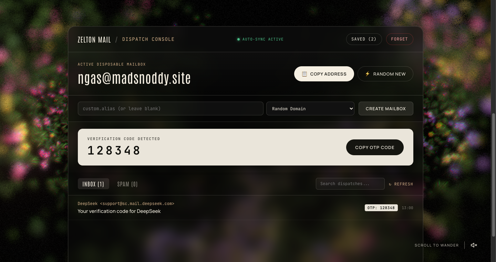
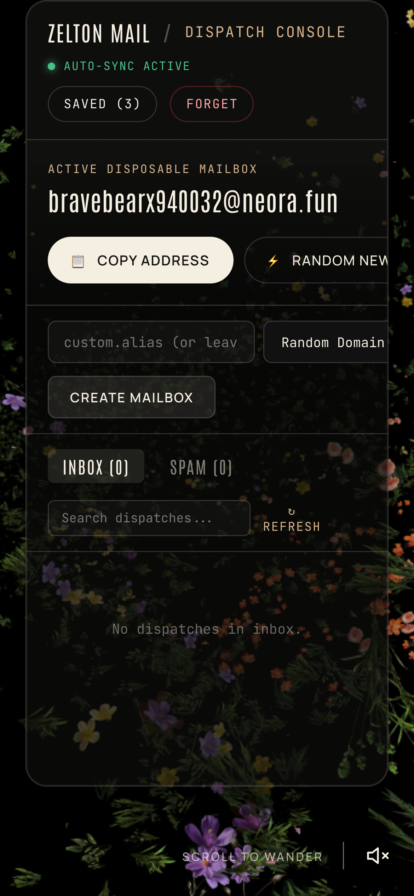
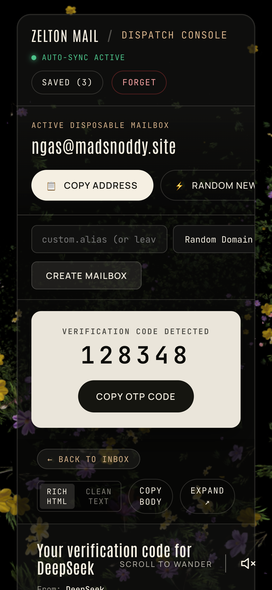

# 📬 Zelton Mail (CustomMails)

<div align="center">


**A minimalist, high-contrast disposable email engine and instant OTP verification console with an interactive Three.js 3D Night Flower Valley canvas.**

[](https://custommails.vercel.app/)
[](https://threejs.org/)
[](https://nodejs.org/)
[](package.json)
[](LICENSE)

[**✨ Open Live Mailbox**](https://custommails.vercel.app/) • [**⚡ Instant OTP System**](#-instant-otp-resolution) • [**📱 Mobile Experience**](#-mobile-responsive-console) • [**🚀 Running Locally**](#-running-locally)

</div>

---

## 🌟 Overview

**Zelton Mail** combines real disposable email dispatching with a peaceful interactive 3D WebGL flower valley aesthetic. Backed by lightweight server engines (zero-dependency Node.js and native Python 3), it allows you to generate temporary mailboxes on the fly, bypass signup gates, and receive incoming verification codes (OTPs) without exposing your personal inbox.

---

## 📸 Interface Showcase

<div align="center">

### Desktop Dispatch Console


*Instant 1-click address copy, active mailbox status, real-time polling, and OTP extraction badge.*

<br/>

### Mobile Optimized Layout
<p align="center">
  
  &nbsp;
  
  &nbsp;
  
</p>

*Touch-friendly compact header, swipeable message lists, and dedicated mobile drawer reader.*

</div>

---

## ✨ Core Features

- **3D Interactive Flower Valley**:
  - Immersive Three.js nighttime botanical landscape with camera path animation and ambient soundscape.
  - Full-screen `100vh` hero viewport on PC with smooth automatic scroll down to the dispatch console upon clicking **LET'S GO**.
  - Dynamic GPU particle lighting and hover dispersal transitions.

- **Instant OTP Resolution**:
  - Automatically parses and extracts verification codes, security pins, and one-time passwords from incoming messages.
  - High-visibility **OTP Hero Card** with monospaced digit formatting and instant 1-click copy.
  - In-feed badge tags so you can grab codes straight from the message preview list.

- **Dual Mode Message Reader**:
  - **Clean Plain Text**: Stripped, high-contrast, distraction-free reading mode.
  - **Rich HTML**: Secure sandboxed `iframe` rendering with `allow-popups` support for verification links.
  - Attachment detection and format categorization.

- **Mailbox Lifecycle & Durability**:
  - Generate instant randomized inboxes (`@domain`) or pick custom local aliases (`user.alias@domain`).
  - Saved inboxes drawer with multi-mailbox switching and state persistence across browser reloads via `localStorage`.
  - Manual 1-click **Forget Mailbox** or auto-purge actions.

- **Zero-Dependency Architecture**:
  - Fully functional Node.js server (`server.js`) built strictly with standard built-in modules (`http`, `https`, `tls`, `fs`, `path`, `url`).
  - Native Python server (`web.py`) and CLI utility (`cli.py`).
  - Edge serverless compatibility ready for Vercel deployment.

---

## 🎮 How to Use

1. **Visit the Console**: Open [https://custommails.vercel.app](https://custommails.vercel.app) or your local instance.
2. **Generate a Mailbox**:
   - Click **LET'S GO** to scroll into the console and provision an instant active mailbox.
   - Or enter a custom alias in the **custom.alias** input and click **CREATE MAILBOX**.
3. **Copy the Address**: Click **COPY** to copy your active disposable address to clipboard.
4. **Receive OTP & Emails**: Paste the address into any service registration. Within seconds, your verification message will appear in the live feed.
5. **Copy the Code**: Tap **COPY CODE** on the OTP banner to copy the 4–8 digit verification code instantly!

---

## 🚀 Running Locally

### Option 1: Node.js (Zero external dependencies)
```bash
# Clone the repository
git clone https://github.com/void4alt/custommails.git
cd custommails

# Start server
npm start
# or: node server.js
```
Open [http://127.0.0.1:8788](http://127.0.0.1:8788) in your web browser.

### Option 2: Python 3
```bash
python3 web.py
```

### Option 3: Command-Line Interface (CLI)
```bash
python3 cli.py health
python3 cli.py domains
python3 cli.py create
```

---

## ☁️ Deploying to Vercel

The project includes an optimized `vercel.json` and standalone root `server.js` handler:

```bash
# Install Vercel CLI if needed
npm install -g vercel

# Deploy directly
vercel --prod
```

---

## 🛠️ Tech Stack

- **Client**: HTML5, Three.js WebGL, CSS Custom Properties, Vanilla JavaScript (ES6+).
- **Audio**: Web Audio API ambient sound engine.
- **Backend**: Node.js standard runtime (`http`/`https`/`tls`), Python 3 `http.server`.
- **Hosting**: Vercel Edge Serverless Function & CDN.

---

## 📄 License

Distributed under the **MIT License**. See `LICENSE` for details.

<div align="center">
  <sub>Crafted with 📬 by <a href="https://github.com/void4alt">void4alt</a></sub>
</div>
